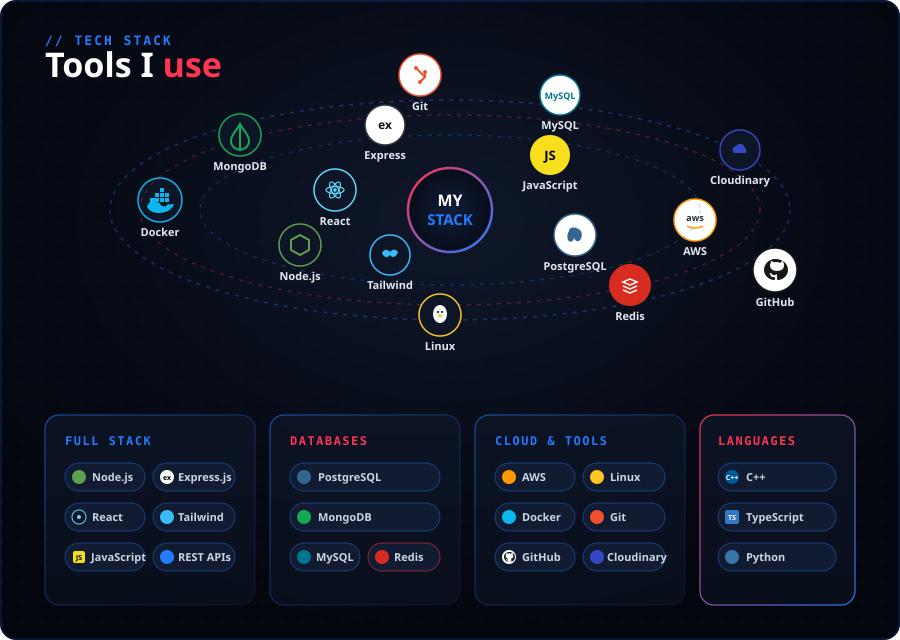

  

  

  
  
  

## Featured projects

| Project | Description | Repository |
| --- | --- | --- |
| **AI Code Review** | A web application for reviewing code and inspecting changes. | [View project](https://github.com/uttammaji/Ai_Code_Review) |
| **Student Information System** | A web application for managing student information. | [View project](https://github.com/uttammaji/Studen_information_system) |
| **Event Booking System** | An application concept for managing event bookings. | [View project](https://github.com/uttammaji/EventBookingSystem) |
| **Freelancer Marketplace** | A JavaScript group project for a freelancer marketplace. | [View project](https://github.com/uttammaji/Freelancer-Marketplace) |
| **Gym** | A web application built with React, Express, and Node.js. | [View project](https://github.com/uttammaji/Gym) |
| **Voice Assistance** | A voice assistant project built with JavaScript. | [View project](https://github.com/uttammaji/Voice-Assistance) |

